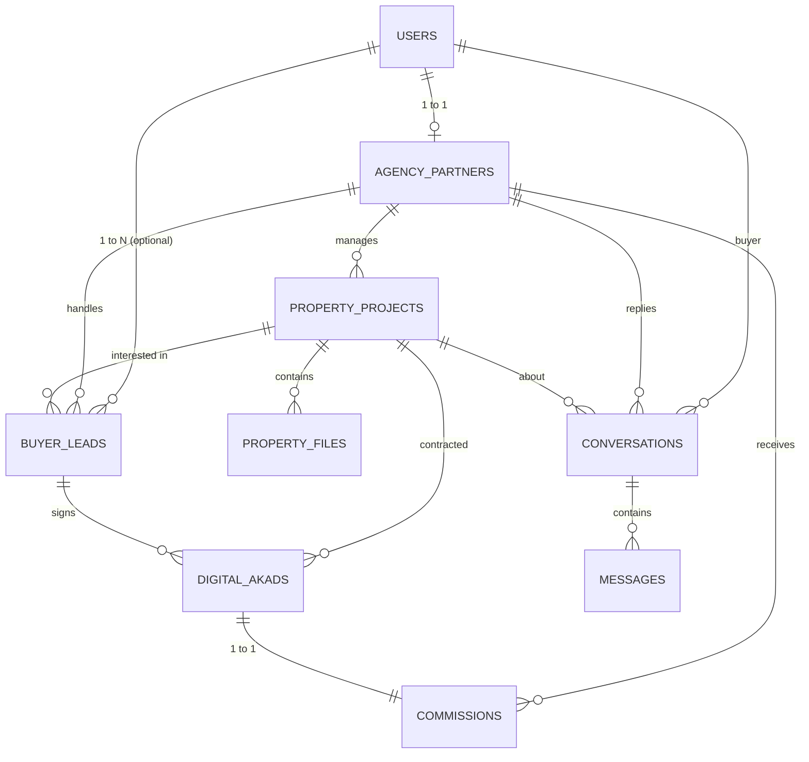

# GalleryProperty

> **Platform Digital Kurasi & Transaksi Properti Murni Syariah bagi Keluarga Muslim, Pengembang, dan Mitra Agency**

---

## 1. Tentang Proyek

### A. Problem Statement
Keluarga muslim kesulitan mencari, memvalidasi legalitas, dan membeli properti yang benar-benar murni syariah (terbebas dari akad riba, denda keterlambatan, sita paksa sepihak, dan asuransi non-halal). Di sisi lain, penjual/pengembang dan mitra agency kesulitan menyaring calon pembeli yang kredibel (*qualified leads*) serta membutuhkan transparansi dalam penerbitan akad digital (MOU) dan penghitungan bagi hasil komisi penjualan.
- **Dampak**: Risiko sengketa perdata, ketidaksesuaian rukun dan syarat jual beli syariah, serta ketidakjelasan hak komisi pemasar.

### B. Solusi Satu Kalimat
Sebagai wadah terpercaya untuk mencari, menyaring, dan bertransaksi properti halal bagi penjual, agency partner, dan keluarga muslim pembeli secara transparan, aman, dan berlandaskan akad syariah.

### C. Stack Teknologi & Versi
- **Framework**: Laravel 13 (`^13.0`)
- **Bahasa**: PHP 8.3+
- **Basis Data**: SQLite 3 (Database File: `database/database.sqlite`)
- **Arsitektur**: MVC dengan Eloquent ORM & Single Table Authentication terpadu

### D. Alur Bisnis
1. **Agency mengajukan listing.** Agency partner mengisi data projek beserta berkasnya, termasuk PKS atau surat kuasa dari developer. Listing tersimpan sebagai draft (belum tayang).
2. **Admin memverifikasi dan menayangkan.** Admin memeriksa legalitas, kesesuaian syariah, dan dokumen kuasa developer, lalu menayangkan listing. Hanya admin yang dapat menayangkan listing.
3. **Buyer tertarik.** Calon pembeli menemukan properti di katalog dan menghubungi agency melalui chat di website. Lead otomatis tercatat.
4. **Agency menindaklanjuti.** Agency melakukan survei dan booking bersama calon pembeli.
5. **Transaksi terjadi.** Akad digital diterbitkan dan ditandatangani oleh pembeli, agency, dan developer (diwakili agency).
6. **Komisi dicairkan.** Komisi dibuat dari akad yang sudah ditandatangani ketiga pihak, lalu disetujui dan dicatat pencairannya oleh admin.

### E. Asumsi MVP
- **Developer tidak memiliki akun.** Developer berhubungan langsung dengan agency berdasarkan perjanjian kerja sama (PKS) di luar sistem. Nama developer cukup dicatat sebagai teks di data projek.
- **Agency menandatangani akad atas nama developer** sebagai wakil (*wakalah*). Karena itu, listing wajib dilengkapi PKS atau surat kuasa developer (tipe berkas *Dokumen Legalitas*), dan admin tidak menayangkan listing tanpa dokumen tersebut.
- **Pembayaran terjadi di luar sistem.** Pembayaran properti dan komisi (dari developer ke agency, dipotong biaya platform) dilakukan di luar sistem. Sistem hanya mencatat nilai, status, dan bukti transfernya.
- **Role developer** baru akan dipertimbangkan pada fase berikutnya, misalnya jika developer perlu memantau listing atau penjualannya sendiri.

> **Catatan implementasi:** langkah 1, 2, 3, dan 6 sudah diterapkan di aplikasi (menu **Listing Saya** untuk agency, **Katalog** publik, dan **Chat**). Langkah 4 dan 5 (survei, booking, penerbitan akad) masih dicatat oleh admin melalui menu **Kelola Data**.

### F. Limitasi Saat Ini
- **Email belum terkirim sungguhan.** Aplikasi belum terhubung ke layanan pengirim email (`MAIL_MAILER=log`), sehingga email hanya tercatat di `storage/logs/laravel.log`. Akibatnya:
  - Fitur **Lupa kata sandi** belum bisa dipakai pengguna. Sebagai gantinya, admin mengganti kata sandi pengguna lewat menu **Kelola Pengguna**.
  - Tidak ada verifikasi email saat registrasi.
- **Agency belum bisa mendaftar sendiri.** Admin membuat akun ber-role Mitra Agency, lalu membuat dan memverifikasi profil agency-nya.
- **Chat tidak real-time sungguhan.** Pesan baru diperiksa setiap 5 detik, bukan lewat websocket.
- **Lead dari chat belum memiliki nomor WhatsApp** (tercatat `-`), karena registrasi tidak meminta nomor. Admin perlu mengisinya sebelum menyimpan perubahan lead.
- **Foto & dokumen pada data contoh (seeder) hanya berupa nama file**, sehingga belum tampil di katalog sampai diunggah ulang.
- **Developer tidak memiliki akun** dan **pembayaran terjadi di luar sistem** (lihat Asumsi MVP).

---

## 2. Struktur Tim & Pembagian Peran

| Peran Tim | Tanggung Jawab Utama |
| :--- | :--- |
| **Product Owner & Syariah Compliance** | Menetapkan batasan rukun akad syariah (Istishna, Murabahah, dll), SOP komisi, dan kurasi legalitas properti. |
| **Backend & Database Engineer** | Merancang skema tabel, integritas foreign key, migrasi SQLite, model Eloquent, serta kalkulasi komisi otomatis. |
| **Frontend & UI/UX Specialist** | Mengembangkan antarmuka katalog pencarian, filter kriteria ramah keluarga, formulir leads, dan penandatanganan akad digital. |
| **Quality Assurance (QA)** | Melakukan verifikasi data seed, audit constraint unik, pengujian autentikasi multi-peran, dan uji alur transaksi. |

---

## 3. Fitur Inti & 5 MVP Utama

### 3 Fitur Inti (Penyelesai Masalah Pengguna):
1. **Upload File & Listing Katalog Properti Halal**:
   - Menampilkan detail unit dengan filter kriteria: lokasi (provinsi/kota), rentang harga, tipe properti, dan skema pembayaran syariah.
   - Mengelola upload multi-file: foto tampak depan utama, denah/siteplan arah kiblat, brosur skema angsuran developer, dan dokumen fatwa/legalitas syariah.
2. **Registrasi & Screening Calon Pembeli (Buyer Profiling)**:
   - Formulir pendaftaran minat khusus keluarga muslim: kesiapan anggaran, preferensi lokasi perumahan islami (dekat masjid/pesantren), dan pelacakan status prospek (*leads pipeline*).
3. **Akad (MOU) Digital & Kalkulasi Komisi Transparan**:
   - Penerbitan surat perjanjian dan akad syariah berpenomoran unik resmi (`AKAD/YYYYMM/XXXX`).
   - Penandatanganan digital 3 pihak (Pembeli, Agency Partner, Pengembang).
   - Perhitungan otomatis komisi agen berdasarkan persentase kesepakatan dan potongan biaya platform.

### 5 MVP Utama:
- [x] Data Agency Partner (Kantor mitra, izin usaha, rekening bank syariah)
- [x] Akad Digital (MOU keagenan, akad istishna, murabahah, peminatan)
- [x] Daftar Projek Properti (Rumah, kavling, ruko syariah terkurasi)
- [x] Registrasi Calon Pembeli (Profiling kebutuhan keluarga muslim)
- [x] Perhitungan Komisi (Otomatisasi bagi hasil komisi agen)

### User Story & Acceptance Criteria (MVP)

Satu user story untuk setiap MVP (US-01 sampai US-05), ditambah story sesuai [Alur Bisnis](#d-alur-bisnis): chat (US-06) dan pengajuan listing oleh agency (US-07). Semua story sudah diimplementasi dan diuji otomatis (`tests/Feature/AdminDataCrudTest.php` dan `tests/Feature/ListingChatFlowTest.php`).

**Berlaku untuk US-01 sampai US-05:**
- Hanya akun ber-role `admin` yang bisa mengakses halaman kelola data. Role lain mendapat respons 403, dan pengunjung yang belum login diarahkan ke halaman login.
- Setiap data bisa ditambah, dilihat detailnya, diubah, dan dihapus. Halaman daftar menyediakan pencarian, filter, dan pembagian halaman (10 data per halaman).
- Input yang tidak valid ditolak dengan pesan error di kolom terkait, dan isian sebelumnya tetap tersimpan di form.

#### US-01 — Data Agency Partner
> Sebagai **Admin**, saya ingin mendaftarkan dan memverifikasi profil agency partner, agar hanya mitra terverifikasi dengan rekening bank syariah yang dapat bertransaksi.

**Acceptance Criteria:**
1. Kolom wajib: akun pemilik, nama agency, dan status verifikasi.
2. Akun pemilik hanya bisa dipilih dari akun ber-role `agency_partner` yang belum memiliki profil agency (satu akun = satu agency).
3. Bank hanya bisa dipilih dari: Bank Syariah Indonesia (BSI), Bank Muamalat, atau BCA Syariah.
4. Saat status diubah menjadi **Terverifikasi**, tanggal verifikasi terisi otomatis. Saat status diubah ke selain itu, tanggal verifikasi dikosongkan.
5. Agency yang masih memiliki riwayat komisi tidak dapat dihapus, dan sistem menampilkan pesan penolakan.
6. Daftar agency bisa dicari berdasarkan nama agency, nomor izin, atau nama/email pemilik, dan bisa difilter berdasarkan status verifikasi.

#### US-02 — Daftar Projek Properti
> Sebagai **Admin**, saya ingin mengelola listing projek properti beserta berkas pendukungnya, agar katalog hanya berisi properti syariah yang terkurasi dan lengkap dokumennya.

**Acceptance Criteria:**
1. Kolom wajib: judul, developer, tipe properti (Rumah / Tanah Kavling / Ruko), skema syariah (Istishna / Murabahah / Cash Bertahap / Cash Keras), harga, persentase komisi, provinsi, kota, alamat lengkap, deskripsi, dan status (Tersedia / Dipesan / Terjual Habis).
2. Slug URL dibuat otomatis dari judul dan selalu unik. Judul yang sama menghasilkan akhiran `-2`, `-3`, dan seterusnya.
3. Persentase komisi harus bernilai 0–100.
4. Projek yang dihapus menggunakan *soft delete*: data hilang dari daftar tetapi tetap tersimpan di database.
5. Berkas projek dapat diunggah dalam format JPG/PNG/WEBP/PDF dengan ukuran maksimal 5 MB, dengan tipe Foto / Siteplan / Brosur PDF / Dokumen Legalitas.
6. Setiap projek hanya memiliki satu berkas utama. Menandai berkas baru sebagai utama otomatis melepas status utama berkas lain di projek yang sama.
7. Saat berkas diganti atau dihapus, file fisik lamanya ikut dihapus dari penyimpanan.
8. Projek hanya bisa diverifikasi dan ditayangkan di katalog jika sudah memiliki minimal satu berkas **Dokumen Legalitas** (PKS / surat kuasa developer).

#### US-03 — Registrasi Calon Pembeli
> Sebagai **Admin**, saya ingin mencatat profil kebutuhan calon pembeli dan melacak status prospeknya, agar leads yang kredibel dapat ditindaklanjuti oleh agency.

**Acceptance Criteria:**
1. Kolom wajib: nama lengkap, nomor WhatsApp, dan status lead.
2. Kolom opsional: akun pembeli (role `buyer`), projek yang diminati, agency penanggung jawab, anggaran minimum/maksimum, lokasi, dan skema syariah yang diminati.
3. Anggaran maksimum tidak boleh lebih kecil dari anggaran minimum.
4. Status lead mengikuti alur: Lead Baru → Jadwal Survei → Prospek Booking → Proses Akad → Closing, atau Batal.
5. Lead yang sudah memiliki akad digital tidak dapat dihapus.
6. Daftar lead bisa dicari berdasarkan nama, nomor WhatsApp, atau email, dan bisa difilter berdasarkan status dan agency.

#### US-04 — Akad Digital
> Sebagai **Admin**, saya ingin menerbitkan akad digital dan mencatat tanda tangan ketiga pihak, agar setiap transaksi memiliki bukti perjanjian syariah yang sah dan terlacak.

**Acceptance Criteria:**
1. Kolom wajib: calon pembeli (lead), projek, jenis akad (Akad Istishna / Akad Murabahah / MOU Peminatan / MOU Keagenan), nilai transaksi, uang muka (DP), tenor, isi akad, dan status (Draft / Menunggu Tanda Tangan / Ditandatangani / Dibatalkan).
2. Nomor akad dibuat otomatis saat disimpan dengan format `AKAD/YYYYMM/XXXX`, unik dan berurutan per bulan. Nomor ini tidak bisa diubah.
3. Uang muka tidak boleh melebihi nilai transaksi, dan tenor harus bernilai 0–600 bulan.
4. Waktu tanda tangan Pembeli, Agency, dan Developer dicatat terpisah. Akad ditandai "Lengkap ditandatangani 3 pihak" hanya jika ketiganya terisi.
5. Dokumen akad dapat diunggah dalam format PDF dengan ukuran maksimal 5 MB (opsional).
6. Menghapus akad ikut menghapus data komisi yang terhubung dengannya.

#### US-05 — Perhitungan Komisi
> Sebagai **Admin**, saya ingin sistem menghitung komisi agen secara otomatis dari setiap akad, agar bagi hasil komisi transparan dan bebas salah hitung.

**Acceptance Criteria:**
1. Setiap komisi terhubung ke tepat satu akad, dan satu akad hanya boleh memiliki satu data komisi. Komisi hanya bisa dibuat dari akad berstatus **Ditandatangani** yang sudah ditandatangani pembeli, agency, dan developer.
2. Kolom wajib: akad, agency penerima, nilai transaksi, persentase komisi, biaya platform, dan status (Pending / Disetujui / Dibayar / Dibatalkan).
3. Sistem menghitung otomatis:
   - **Total komisi** = nilai transaksi × persentase komisi
   - **Komisi bersih** = total komisi − biaya platform
4. Biaya platform yang melebihi total komisi ditolak.
5. Jika status **Dibayar** dipilih tanpa tanggal pembayaran, tanggal pembayaran terisi otomatis dengan waktu saat itu.
6. Bukti transfer dapat diunggah dalam format JPG/PNG/WEBP/PDF dengan ukuran maksimal 5 MB (opsional).

#### US-06 — Chat Calon Pembeli dengan Agency Partner
> Sebagai **Calon Pembeli**, saya ingin bertanya langsung kepada agency partner tentang projek yang saya minati melalui chat di website, agar semua komunikasi tercatat di satu tempat tanpa harus membagikan nomor pribadi.

**Acceptance Criteria:**
1. Tombol **Chat Agency** tampil di halaman detail projek dan terhubung ke agency penanggung jawab projek tersebut. Projek tanpa agency tidak menampilkan tombol ini.
2. Pengunjung yang belum login diarahkan ke halaman login/registrasi sebelum bisa memulai chat. Hanya akun ber-role `buyer` yang dapat memulai percakapan.
3. Satu calon pembeli memiliki satu percakapan per projek. Membuka chat untuk projek yang sama melanjutkan percakapan lama beserta riwayat pesannya.
4. Chat adalah satu-satunya jalur kontak: nomor WhatsApp dan email agency tidak ditampilkan kepada calon pembeli.
5. Agency partner melihat daftar percakapan yang ditujukan kepadanya saja, lengkap dengan penanda pesan yang belum dibaca, dan dapat membalas. Pesan baru muncul otomatis di halaman chat (diperbarui setiap 5 detik) tanpa perlu reload.
6. Percakapan hanya dapat dibaca oleh calon pembeli dan agency partner yang terlibat. Pengguna lain yang mencoba membukanya mendapat respons 403.
7. Pesan tidak boleh kosong dan maksimal 1.000 karakter.
8. Pesan pertama dari calon pembeli otomatis membuat data lead (status **Lead Baru**) yang terhubung ke akun pembeli, projek, dan agency, jika lead tersebut belum ada.

#### US-07 — Pengajuan Listing oleh Agency Partner
> Sebagai **Agency Partner**, saya ingin mengajukan listing projek dari developer yang saya wakili, agar projek tersebut bisa ditayangkan setelah diverifikasi admin.

**Acceptance Criteria:**
1. Hanya agency partner berstatus **Terverifikasi** yang dapat mengajukan listing.
2. Listing yang diajukan otomatis terhubung ke agency pengaju dan tersimpan sebagai draft (`is_verified` = false), sehingga belum tampil di katalog.
3. Pengajuan wajib melampirkan minimal satu berkas **Dokumen Legalitas** berupa PKS atau surat kuasa dari developer.
4. Agency hanya dapat melihat dan mengubah listing miliknya sendiri, dan hanya selama listing tersebut belum ditayangkan.
5. Hanya admin yang dapat menayangkan listing. Listing yang belum memiliki dokumen kuasa developer tidak dapat ditayangkan.
6. Agency dapat melihat status pengajuannya: menunggu verifikasi atau sudah tayang.

---

## 4. Kebijakan Akun & Hak Akses (Access Control Policy)

### A. Matriks Hak Akses

| Peran (*Role*) | Kebijakan Akun | Hak Akses Utama |
| :--- | :--- | :--- |
| **`admin`** | Akun internal (disediakan sistem). | Akses penuh: verifikasi agency partner, **verifikasi dan penayangan listing projek properti** (hanya admin yang dapat menayangkan), audit dokumen akad, dan persetujuan pencairan komisi. |
| **`agency_partner`** | Registrasi mitra + wajib verifikasi profil oleh Admin. | Mengajukan listing projek (draft, wajib melampirkan PKS/surat kuasa developer), membalas chat dari calon pembeli, mendaftarkan leads pembeli binaan, menandatangani akad (termasuk atas nama developer), dan memantau riwayat komisi. Tidak dapat menayangkan listing sendiri. |
| **`buyer`** | Registrasi publik terbuka untuk keluarga muslim. | Mencari & filter katalog properti, menghubungi agency partner **hanya melalui chat di website**, dan menandatangani akad digital secara mandiri. |

### B. Kebijakan Keamanan & Rekening
1. **Identitas Unik**: Email dan nomor WhatsApp (`phone`) wajib unik untuk mencegah duplikasi akun prospek dan mitra.
2. **Status Akun**:
   - `pending`: Menunggu persetujuan berkas legalitas agen oleh Admin.
   - `active`: Akun aktif dan dapat bertransaksi penuh.
   - `suspended`: Akun dinonaktifkan jika melanggar ketentuan syariah atau etika bisnis.
3. **Rekening Komisi**: Agency partner wajib mendaftarkan rekening pada bank syariah resmi (Bank Syariah Indonesia / Bank Muamalat / BCA Syariah).

---

## 5. Bukti Pengujian Autentikasi (Login Verification Proof)

Pengujian dilakukan menggunakan metode `Auth::attempt()` bawaan Laravel terhadap seluruh peran pengguna:

```text
=======================================================
BUKTI PENGUJIAN LOGIN (AUTHENTICATION TEST)
=======================================================

1. Pengujian Akun: Super Admin
 - Kredensial : admin@galerypropertysyariah.com / admin123
 - Hasil      : BERHASIL (Authenticated)
 - User ID    : 1 | Role: admin | Status: active
 - Validasi   : PASS

2. Pengujian Akun: Agency Partner (Mitra Agen)
 - Kredensial : agency1@galerypropertysyariah.com / password123
 - Hasil      : BERHASIL (Authenticated)
 - User ID    : 2 | Role: agency_partner | Status: active
 - Validasi   : PASS

3. Pengujian Akun: Calon Pembeli (Keluarga Muslim)
 - Kredensial : pembeli1@keluargamuslim.com / password123
 - Hasil      : BERHASIL (Authenticated)
 - User ID    : 7 | Role: buyer | Status: active
 - Validasi   : PASS

4. Pengujian Akun: Password Salah (Negative Testing)
 - Kredensial : admin@galerypropertysyariah.com / passwordsalah
 - Hasil      : DITOLAK (Akses ditolak sesuai aturan keamanan)
 - Validasi   : PASS
=======================================================
```

---

## 6. Skema Basis Data & Desain Entitas



### Rincian Tabel:
1. **`users`**: PK `id`, `name`, `email` (unique), `phone` (unique), `password`, `role` (`admin`, `agency_partner`, `buyer`), `status`.
2. **`agency_partners`**: PK `id`, FK `user_id` (unique, cascade), `agency_name`, `license_number`, `bank_name`, `bank_account_number`, `verification_status`.
3. **`property_projects`**: PK `id`, FK `agency_partner_id` (null on delete), `title`, `slug` (unique), `developer_name`, `property_type`, `syariah_scheme`, `price`, `commission_rate`, `province`, `city`, `district`, `bedroom`, `bathroom`, `building_area`, `land_area`, `is_verified`.
4. **`property_files`**: PK `id`, FK `property_project_id` (cascade), `file_path`, `file_type` (`photo`, `siteplan`, `brochure_pdf`, `legal_doc`), `caption`, `is_primary`.
5. **`buyer_leads`**: PK `id`, FK `user_id`, FK `agency_partner_id`, FK `property_project_id`, `full_name`, `phone`, `budget_min`, `budget_max`, `preferred_location`, `status`.
6. **`digital_akads`**: PK `id`, `akad_number` (unique), FK `property_project_id` (restrict), FK `buyer_lead_id` (restrict), FK `agency_partner_id`, `akad_type`, `transaction_amount`, `dp_amount`, `tenor_months`, `terms_content`, `buyer_signed_at`, `agency_signed_at`, `developer_signed_at`, `status`.
7. **`commissions`**: PK `id`, FK `digital_akad_id` (unique, cascade), FK `agency_partner_id` (restrict), `base_transaction_amount`, `commission_rate`, `total_commission`, `platform_fee`, `net_commission`, `status`, `paid_at`.
8. **`conversations`**: PK `id`, FK `buyer_id` (cascade), FK `agency_partner_id` (cascade), FK `property_project_id` (cascade), `buyer_last_read_message_id`, `agency_last_read_message_id`, `last_message_at`. Unik per (`buyer_id`, `property_project_id`).
9. **`messages`**: PK `id`, FK `conversation_id` (cascade), FK `sender_id` (cascade), `body`.

---

## 7. Panduan Setup, Migrasi & Seeding

Untuk anggota tim yang baru mengklon repositori ini, ikuti langkah berikut:

### Langkah 1: Klon & Masuk Direktori
```bash
git clone <repository-url>
cd GaleryProperty
```

### Langkah 2: Instal Dependensi PHP
```bash
composer install
```

### Langkah 3: Konfigurasi Environment & SQLite
Salin file environment:
```bash
cp .env.example .env
php artisan key:generate
```
Pastikan pada `.env` telah menggunakan koneksi SQLite:
```env
DB_CONNECTION=sqlite
```
Buat file SQLite jika belum ada:
```bash
# Windows PowerShell:
New-Item -ItemType File -Path database\database.sqlite -Force

# Linux / Mac:
touch database/database.sqlite
```

### Langkah 4: Jalankan Migrasi & Seeder
```bash
php artisan migrate:fresh --seed
```

### Langkah 5: Cek Status Migrasi
```bash
php artisan migrate:status
```
*(Seluruh migrasi wajib bertanda `Ran`)*.

### Langkah 6: Jalankan Server Lokal
```bash
php artisan serve
```
Akses aplikasi melalui peramban web di: `http://localhost:8000`.

### Langkah 7: Demo
Ikuti naskah demo per peran dan skenario lengkapnya di [docs/DEMO.md](docs/DEMO.md).

---

## 8. Bukti Hasil Verifikasi Data (*Expected vs Actual*)

Hasil audit integritas data pasca eksekusi `php artisan db:seed`:

| Nama Tabel | Model Eloquent | Expected | Actual | Status Audit | Keterangan Data |
| :--- | :--- | :---: | :---: | :---: | :--- |
| `users` | `App\Models\User` | 21 | 21 | **MATCH** | 1 Admin, 5 Agen Mitra, 15 Calon Pembeli |
| `agency_partners` | `App\Models\AgencyPartner` | 5 | 5 | **MATCH** | 5 Kantor Agency Properti Syariah Terverifikasi |
| `property_projects`| `App\Models\PropertyProject`| 10 | 10 | **MATCH** | 10 Projek (Rumah, Kavling, Ruko Syariah) |
| `property_files` | `App\Models\PropertyFile` | 30 | 30 | **MATCH** | 3 Berkas per unit (Fasad, Denah, Legalitas) |
| `buyer_leads` | `App\Models\BuyerLead` | 15 | 15 | **MATCH** | 15 Leads Pembeli dengan profiling kriteria |
| `digital_akads` | `App\Models\DigitalAkad` | 6 | 6 | **MATCH** | 6 Akad MOU Digital tertandatangani lengkap |
| `commissions` | `App\Models\Commission` | 6 | 6 | **MATCH** | 6 Perhitungan komisi agen terikat 1-to-1 |

### Audit Foreign Key & Relasi:
- **`User -> AgencyPartner`**: `PASS` (Akun agen terhubung ke profil agency).
- **`AgencyPartner -> PropertyProjects`**: `PASS` (Listing terhubung ke agency penanggung jawab).
- **`PropertyProject -> PropertyFiles`**: `PASS` (Foto dan berkas legalitas terhubung per unit).
- **`BuyerLead -> Properti & Agency`**: `PASS` (Atribusi prospek pembeli valid).
- **`DigitalAkad -> Commission`**: `PASS` (Kalkulasi komisi bersih terbukti akurat).

---

## 9. Lisensi & Hak Cipta
Hak Cipta &copy; 2026 **GalleryProperty**. Dikembangkan untuk kemaslahatan transaksi properti keluarga muslim tanpa riba.
                                                                                                               