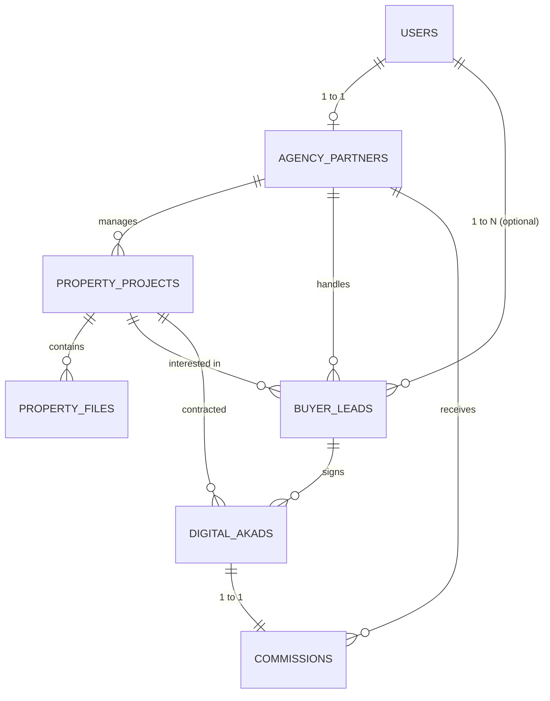

# Galery Property Halal

> **Platform Digital Kurasi & Transaksi Properti Murni Syariah bagi Keluarga Muslim, Pengembang, dan Mitra Agency**

---

## 1. Tentang Proyek

### A. Problem Statement
Keluarga muslim kesulitan mencari, memvalidasi legalitas, dan membeli properti yang benar-benar murni syariah (terbebas dari akad riba, denda keterlambatan, sita paksa sepihak, dan asuransi non-halal). Di sisi lain, penjual/pengembang dan mitra agency kesulitan menyaring calon pembeli yang kredibel (*qualified leads*) serta membutuhkan transparansi dalam penerbitan akad digital (MOU) dan penghitungan bagi hasil komisi penjualan.
- **Dampak**: Risiko sengketa perdata, ketidaksesuaian rukun dan syarat jual beli syariah, serta ketidakjelasan hak komisi pemasar.

### B. Solusi Satu Kalimat
Sebagai wadah terpercaya untuk mencari, menyaring, dan bertransaksi properti halal bagi penjual, agency partner, dan keluarga muslim pembeli secara transparan, aman, dan berlandaskan akad syariah.

### C. Stack Teknologi & Versi
- **Framework**: Laravel 13 (`^13.0`)
- **Bahasa**: PHP 8.3+
- **Basis Data**: SQLite 3 (Database File: `database/database.sqlite`)
- **Arsitektur**: MVC dengan Eloquent ORM & Single Table Authentication terpadu

---

## 2. Struktur Tim & Pembagian Peran

| Peran Tim | Tanggung Jawab Utama |
| :--- | :--- |
| **Product Owner & Syariah Compliance** | Menetapkan batasan rukun akad syariah (Istishna, Murabahah, dll), SOP komisi, dan kurasi legalitas properti. |
| **Backend & Database Engineer** | Merancang skema tabel, integritas foreign key, migrasi SQLite, model Eloquent, serta kalkulasi komisi otomatis. |
| **Frontend & UI/UX Specialist** | Mengembangkan antarmuka katalog pencarian, filter kriteria ramah keluarga, formulir leads, dan penandatanganan akad digital. |
| **Quality Assurance (QA)** | Melakukan verifikasi data seed, audit constraint unik, pengujian autentikasi multi-peran, dan uji alur transaksi. |

---

## 3. Fitur Inti & 5 MVP Utama

### 3 Fitur Inti (Penyelesai Masalah Pengguna):
1. **Upload File & Listing Katalog Properti Halal**:
   - Menampilkan detail unit dengan filter kriteria: lokasi (provinsi/kota), rentang harga, tipe properti, dan skema pembayaran syariah.
   - Mengelola upload multi-file: foto tampak depan utama, denah/siteplan arah kiblat, brosur skema angsuran developer, dan dokumen fatwa/legalitas syariah.
2. **Registrasi & Screening Calon Pembeli (Buyer Profiling)**:
   - Formulir pendaftaran minat khusus keluarga muslim: kesiapan anggaran, preferensi lokasi perumahan islami (dekat masjid/pesantren), dan pelacakan status prospek (*leads pipeline*).
3. **Akad (MOU) Digital & Kalkulasi Komisi Transparan**:
   - Penerbitan surat perjanjian dan akad syariah berpenomoran unik resmi (`AKAD/YYYYMM/XXXX`).
   - Penandatanganan digital 3 pihak (Pembeli, Agency Partner, Pengembang).
   - Perhitungan otomatis komisi agen berdasarkan persentase kesepakatan dan potongan biaya platform.

### 5 MVP Utama:
- [x] Data Agency Partner (Kantor mitra, izin usaha, rekening bank syariah)
- [x] Akad Digital (MOU keagenan, akad istishna, murabahah, peminatan)
- [x] Daftar Projek Properti (Rumah, kavling, ruko syariah terkurasi)
- [x] Registrasi Calon Pembeli (Profiling kebutuhan keluarga muslim)
- [x] Perhitungan Komisi (Otomatisasi bagi hasil komisi agen)

---

## 4. Kebijakan Akun & Hak Akses (Access Control Policy)

### A. Matriks Hak Akses

| Peran (*Role*) | Kebijakan Akun | Hak Akses Utama |
| :--- | :--- | :--- |
| **`admin`** | Akun internal (disediakan sistem). | Akses penuh: verifikasi agency partner, kurasi projek properti halal, audit dokumen akad, dan persetujuan pencairan komisi. |
| **`agency_partner`** | Registrasi mitra + wajib verifikasi profil oleh Admin. | Menambahkan listing projek properti, mendaftarkan leads pembeli binaan, menandatangani draft MOU, dan memantau riwayat komisi. |
| **`buyer`** | Registrasi publik terbuka untuk keluarga muslim. | Mencari & filter katalog properti, mengajukan formulir minat/booking, dan menandatangani akad digital secara mandiri. |

### B. Kebijakan Keamanan & Rekening
1. **Identitas Unik**: Email dan nomor WhatsApp (`phone`) wajib unik untuk mencegah duplikasi akun prospek dan mitra.
2. **Status Akun**:
   - `pending`: Menunggu persetujuan berkas legalitas agen oleh Admin.
   - `active`: Akun aktif dan dapat bertransaksi penuh.
   - `suspended`: Akun dinonaktifkan jika melanggar ketentuan syariah atau etika bisnis.
3. **Rekening Komisi**: Agency partner wajib mendaftarkan rekening pada bank syariah resmi (Bank Syariah Indonesia / Bank Muamalat / BCA Syariah).

---

## 5. Bukti Pengujian Autentikasi (Login Verification Proof)

Pengujian dilakukan menggunakan metode `Auth::attempt()` bawaan Laravel terhadap seluruh peran pengguna:

```text
=======================================================
BUKTI PENGUJIAN LOGIN (AUTHENTICATION TEST)
=======================================================

1. Pengujian Akun: Super Admin
 - Kredensial : admin@galerypropertysyariah.com / admin123
 - Hasil      : BERHASIL (Authenticated)
 - User ID    : 1 | Role: admin | Status: active
 - Validasi   : PASS

2. Pengujian Akun: Agency Partner (Mitra Agen)
 - Kredensial : agency1@galerypropertysyariah.com / password123
 - Hasil      : BERHASIL (Authenticated)
 - User ID    : 2 | Role: agency_partner | Status: active
 - Validasi   : PASS

3. Pengujian Akun: Calon Pembeli (Keluarga Muslim)
 - Kredensial : pembeli1@keluargamuslim.com / password123
 - Hasil      : BERHASIL (Authenticated)
 - User ID    : 7 | Role: buyer | Status: active
 - Validasi   : PASS

4. Pengujian Akun: Password Salah (Negative Testing)
 - Kredensial : admin@galerypropertysyariah.com / passwordsalah
 - Hasil      : DITOLAK (Akses ditolak sesuai aturan keamanan)
 - Validasi   : PASS
=======================================================
```

---

## 6. Skema Basis Data & Desain Entitas



### Rincian Tabel:
1. **`users`**: PK `id`, `name`, `email` (unique), `phone` (unique), `password`, `role` (`admin`, `agency_partner`, `buyer`), `status`.
2. **`agency_partners`**: PK `id`, FK `user_id` (unique, cascade), `agency_name`, `license_number`, `bank_name`, `bank_account_number`, `verification_status`.
3. **`property_projects`**: PK `id`, FK `agency_partner_id` (null on delete), `title`, `slug` (unique), `developer_name`, `property_type`, `syariah_scheme`, `price`, `commission_rate`, `province`, `city`, `district`, `bedroom`, `bathroom`, `building_area`, `land_area`, `is_verified`.
4. **`property_files`**: PK `id`, FK `property_project_id` (cascade), `file_path`, `file_type` (`photo`, `siteplan`, `brochure_pdf`, `legal_doc`), `caption`, `is_primary`.
5. **`buyer_leads`**: PK `id`, FK `user_id`, FK `agency_partner_id`, FK `property_project_id`, `full_name`, `phone`, `budget_min`, `budget_max`, `preferred_location`, `status`.
6. **`digital_akads`**: PK `id`, `akad_number` (unique), FK `property_project_id` (restrict), FK `buyer_lead_id` (restrict), FK `agency_partner_id`, `akad_type`, `transaction_amount`, `dp_amount`, `tenor_months`, `terms_content`, `buyer_signed_at`, `agency_signed_at`, `developer_signed_at`, `status`.
7. **`commissions`**: PK `id`, FK `digital_akad_id` (unique, cascade), FK `agency_partner_id` (restrict), `base_transaction_amount`, `commission_rate`, `total_commission`, `platform_fee`, `net_commission`, `status`, `paid_at`.

---

## 7. Panduan Setup, Migrasi & Seeding

Untuk anggota tim yang baru mengklon repositori ini, ikuti langkah berikut:

### Langkah 1: Klon & Masuk Direktori
```bash
git clone <repository-url>
cd "Galery Property"
```

### Langkah 2: Instal Dependensi PHP
```bash
composer install
```

### Langkah 3: Konfigurasi Environment & SQLite
Salin file environment:
```bash
cp .env.example .env
php artisan key:generate
```
Pastikan pada `.env` telah menggunakan koneksi SQLite:
```env
DB_CONNECTION=sqlite
```
Buat file SQLite jika belum ada:
```bash
# Windows PowerShell:
New-Item -ItemType File -Path database\database.sqlite -Force

# Linux / Mac:
touch database/database.sqlite
```

### Langkah 4: Jalankan Migrasi & Seeder
```bash
php artisan migrate:fresh --seed
```

### Langkah 5: Cek Status Migrasi
```bash
php artisan migrate:status
```
*(Seluruh migrasi wajib bertanda `Ran`)*.

### Langkah 6: Jalankan Server Lokal
```bash
php artisan serve
```
Akses aplikasi melalui peramban web di: `http://localhost:8000`.

---

## 8. Bukti Hasil Verifikasi Data (*Expected vs Actual*)

Hasil audit integritas data pasca eksekusi `php artisan db:seed`:

| Nama Tabel | Model Eloquent | Expected | Actual | Status Audit | Keterangan Data |
| :--- | :--- | :---: | :---: | :---: | :--- |
| `users` | `App\Models\User` | 21 | 21 | **MATCH** | 1 Admin, 5 Agen Mitra, 15 Calon Pembeli |
| `agency_partners` | `App\Models\AgencyPartner` | 5 | 5 | **MATCH** | 5 Kantor Agency Properti Syariah Terverifikasi |
| `property_projects`| `App\Models\PropertyProject`| 10 | 10 | **MATCH** | 10 Projek (Rumah, Kavling, Ruko Syariah) |
| `property_files` | `App\Models\PropertyFile` | 30 | 30 | **MATCH** | 3 Berkas per unit (Fasad, Denah, Legalitas) |
| `buyer_leads` | `App\Models\BuyerLead` | 15 | 15 | **MATCH** | 15 Leads Pembeli dengan profiling kriteria |
| `digital_akads` | `App\Models\DigitalAkad` | 6 | 6 | **MATCH** | 6 Akad MOU Digital tertandatangani lengkap |
| `commissions` | `App\Models\Commission` | 6 | 6 | **MATCH** | 6 Perhitungan komisi agen terikat 1-to-1 |

### Audit Foreign Key & Relasi:
- **`User -> AgencyPartner`**: `PASS` (Akun agen terhubung ke profil agency).
- **`AgencyPartner -> PropertyProjects`**: `PASS` (Listing terhubung ke agency penanggung jawab).
- **`PropertyProject -> PropertyFiles`**: `PASS` (Foto dan berkas legalitas terhubung per unit).
- **`BuyerLead -> Properti & Agency`**: `PASS` (Atribusi prospek pembeli valid).
- **`DigitalAkad -> Commission`**: `PASS` (Kalkulasi komisi bersih terbukti akurat).

---

## 9. Lisensi & Hak Cipta
Hak Cipta &copy; 2026 **Galery Property Halal**. Dikembangkan untuk kemaslahatan transaksi properti keluarga muslim tanpa riba.
